# Serveur Linux d'entreprise — Ubuntu Server 26.04 LTS

Projet personnel d'**administration système** réalisé dans une machine virtuelle **VMware**.

L'objectif est de mettre en place un serveur comme dans une petite entreprise : des comptes utilisateurs par service avec des droits séparés, un accès à distance sécurisé, un serveur web, un pare-feu et des sauvegardes automatiques.

**Réalisé par :** Saran Fofana, étudiante en Master 1 Génie Informatique (Université Nangui Abrogoua, Abidjan)

---

## Sommaire

1. [Installation du serveur](#1-installation-du-serveur)
2. [Utilisateurs, groupes et droits](#2-utilisateurs-groupes-et-droits)
3. [Accès SSH sécurisé par clé](#3-accès-ssh-sécurisé-par-clé)
4. [Serveur web Apache](#4-serveur-web-apache)
5. [Pare-feu ufw](#5-pare-feu-ufw)
6. [Sauvegarde automatique (Bash + cron)](#6-sauvegarde-automatique-bash--cron)
7. [Difficultés rencontrées et solutions](#7-difficultés-rencontrées-et-solutions)
8. [Ce que j'ai appris](#8-ce-que-jai-appris)

## Environnement

| Élément | Valeur |
| --- | --- |
| Virtualisation | VMware Workstation |
| Système | Ubuntu Server 26.04.1 LTS |
| Ressources de la VM | 2 processeurs, 4 Go de RAM, disque de 20 Go (LVM) |
| Réseau | NAT — adresse du serveur : 192.168.22.146 |
| Nom du serveur | `srventreprise` |
| Poste d'administration | Windows (PowerShell) |

---

## 1. Installation du serveur

**But :** installer un système Linux serveur propre et à jour, puis relever ses informations (nom, version, adresse IP) pour pouvoir l'administrer à distance.

Installation d'Ubuntu Server dans VMware (clavier français, partitionnement LVM automatique), puis mise à jour du système :

```bash
# Mettre à jour la liste des paquets, puis installer toutes les mises à jour
sudo apt update && sudo apt upgrade -y

# Redémarrer pour appliquer les mises à jour des services
sudo reboot
```

Vérification des informations du serveur :

```bash
# Afficher le nom du serveur, la version d'Ubuntu, le noyau et la virtualisation
hostnamectl

# Afficher les cartes réseau et leurs adresses IP
ip a
```

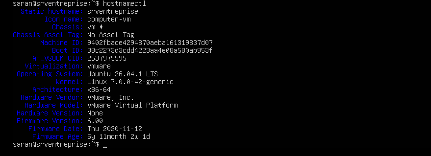

*📷 Pour voir le résultat : capture [`01-hostnamectl.png`](captures/01-hostnamectl.png) — informations du serveur.*

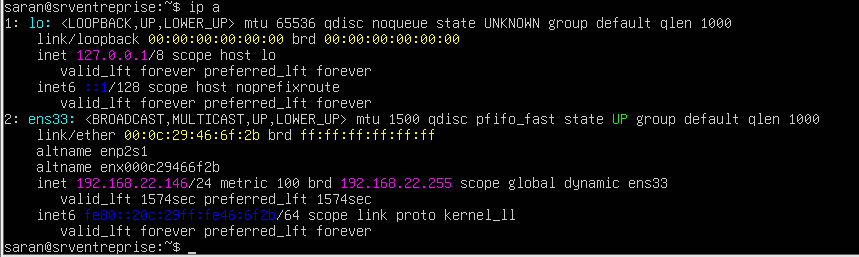

*📷 Pour voir le résultat : capture [`01-ip.png`](captures/01-ip.png) — adresse IP du serveur.*

**Résultat :** le serveur `srventreprise` tourne sous Ubuntu 26.04.1 LTS, avec l'adresse IP **192.168.22.146** sur la carte `ens33`.

---

## 2. Utilisateurs, groupes et droits

**But :** créer deux services de l'entreprise (comptabilité et informatique). Chaque service a un dossier partagé que les autres ne peuvent pas ouvrir.

### Création des groupes et des utilisateurs

```bash
# Créer un groupe pour chaque service
sudo groupadd compta
sudo groupadd informatique

# Créer l'utilisatrice awa et l'ajouter au groupe compta
sudo adduser awa
sudo usermod -aG compta awa

# Créer l'utilisateur koffi et l'ajouter au groupe informatique
sudo adduser koffi
sudo usermod -aG informatique koffi

# Ajouter l'administratrice (saran) au groupe informatique
sudo usermod -aG informatique saran
```

> `-aG` veut dire « ajouter (**a**ppend) à un **G**roupe » sans retirer l'utilisateur de ses autres groupes.

### Création des dossiers partagés

```bash
# Créer les deux dossiers partagés (-p crée aussi les dossiers parents)
sudo mkdir -p /srv/partage/compta /srv/partage/informatique

# Donner chaque dossier au groupe du service correspondant
sudo chown root:compta /srv/partage/compta
sudo chown root:informatique /srv/partage/informatique

# 2770 : propriétaire et groupe ont tous les droits, les autres n'ont aucun accès.
# Le 2 (setgid) fait que les nouveaux fichiers appartiennent automatiquement au groupe.
sudo chmod 2770 /srv/partage/compta /srv/partage/informatique
```

### Vérification

```bash
# Afficher les droits des dossiers partagés
ls -l /srv/partage

# Afficher les groupes de koffi
id koffi
```

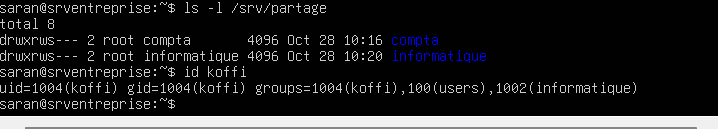

*📷 Pour voir le résultat : capture [`02-droits.png`](captures/02-droits.png) — droits des dossiers.*

Test d'accès en se connectant en tant que koffi :

```bash
su - koffi                        # se connecter en tant que koffi
ls /srv/partage/informatique      # son service : accès autorisé
ls /srv/partage/compta            # autre service : accès refusé
exit                              # revenir au compte saran
```

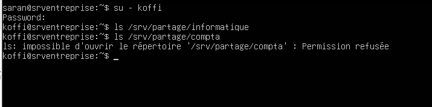

*📷 Pour voir le résultat : capture [`02-test-acces.png`](captures/02-test-acces.png) — test d'accès refusé.*

**Résultat :** koffi peut ouvrir le dossier `informatique`, mais reçoit **« Permission refusée »** pour `compta`. Les droits par groupe fonctionnent.

---

## 3. Accès SSH sécurisé par clé

**But :** administrer le serveur à distance depuis Windows, avec une **clé SSH** à la place du mot de passe, et interdire la connexion par mot de passe et la connexion directe en root.

### Installation et vérification du service SSH

```bash
# Installer le serveur SSH et l'activer au démarrage
sudo apt install openssh-server -y
sudo systemctl enable --now ssh

# Vérifier que le service tourne
systemctl status ssh

# Vérifier que le serveur écoute sur le port 22
sudo ss -tlnp | grep :22
```

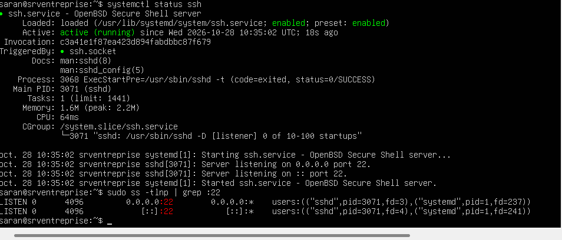

*📷 Pour voir le résultat : capture [`03-ssh-service.png`](captures/03-ssh-service.png) — service SSH actif.*

### Création et installation de la clé (depuis Windows, dans PowerShell)

```powershell
# Créer une paire de clés (privée + publique) sur le PC Windows
ssh-keygen -t ed25519

# Copier la clé publique sur le serveur et protéger le dossier .ssh
type $env:USERPROFILE\.ssh\id_ed25519.pub | ssh saran@192.168.22.146 "mkdir -p ~/.ssh && cat >> ~/.ssh/authorized_keys && chmod 700 ~/.ssh && chmod 600 ~/.ssh/authorized_keys"

# Se connecter : aucun mot de passe n'est demandé
ssh saran@192.168.22.146
```

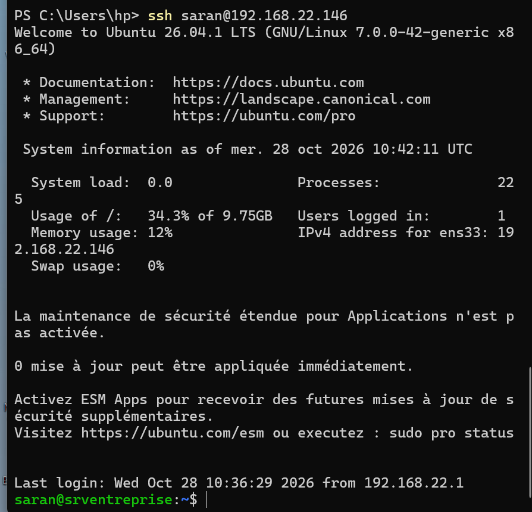

*📷 Pour voir le résultat : capture [`03-ssh-cle.png`](captures/03-ssh-cle.png) — connexion par clé sans mot de passe.*

### Interdiction des mots de passe et du compte root

```bash
# Créer un fichier de configuration SSH. Le nom commence par 01 pour être lu en premier :
# OpenSSH garde la première valeur trouvée pour chaque option.
printf "PasswordAuthentication no\nPermitRootLogin no\n" | sudo tee /etc/ssh/sshd_config.d/01-securite.conf

# Redémarrer SSH pour appliquer la configuration
sudo systemctl restart ssh

# Vérifier la configuration réellement appliquée
sudo sshd -T | grep -E "passwordauthentication|permitrootlogin"
```

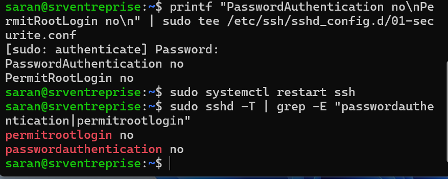

*📷 Pour voir le résultat : capture [`03-sshd-config.png`](captures/03-sshd-config.png) — configuration SSH appliquée.*

Test avec un utilisateur qui n'a pas de clé :

```bash
ssh koffi@192.168.22.146
```

Résultat obtenu :

```
koffi@192.168.22.146: Permission denied (publickey).
```

**Résultat :** seules les connexions par clé sont acceptées. Un utilisateur sans clé reçoit **Permission denied (publickey)**, sans même pouvoir essayer un mot de passe.

Fichier de configuration : [`01-securite.conf`](01-securite.conf)

---

## 4. Serveur web Apache

**But :** héberger une page intranet pour l'entreprise et vérifier qu'elle est accessible depuis un autre ordinateur du réseau.

```bash
# Installer le serveur web Apache
sudo apt install apache2 -y

# Vérifier qu'il tourne
systemctl status apache2 --no-pager
```

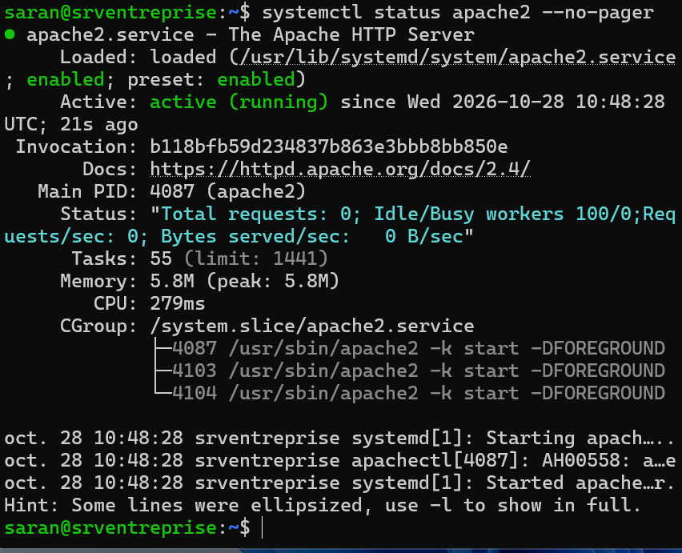

*📷 Pour voir le résultat : capture [`04-apache-status.png`](captures/04-apache-status.png) — Apache actif.*

Correction de l'avertissement `AH00558` (Apache ne connaissait pas le nom du serveur) :

```bash
# Déclarer le nom du serveur dans une configuration Apache
echo "ServerName srventreprise" | sudo tee /etc/apache2/conf-available/servername.conf

# Activer cette configuration, puis recharger Apache sans coupure
sudo a2enconf servername
sudo systemctl reload apache2
```

Création de la page d'accueil :

```bash
# Écrire la page d'accueil du site dans le dossier web d'Apache
echo '<!DOCTYPE html><html lang="fr"><head><meta charset="utf-8"><title>Intranet</title></head><body><h1>Intranet de l&#39;entreprise</h1><p>Serveur srventreprise, administré par Saran Fofana.</p></body></html>' | sudo tee /var/www/html/index.html
```

La page est accessible depuis Windows à l'adresse `http://192.168.22.146` :

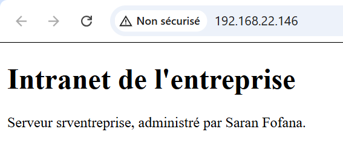

*📷 Pour voir le résultat : capture [`04-page-web.png`](captures/04-page-web.png) — page web dans le navigateur.*

Lecture du journal des visites :

```bash
# Afficher les 5 dernières requêtes reçues par Apache
sudo tail -n 5 /var/log/apache2/access.log
```

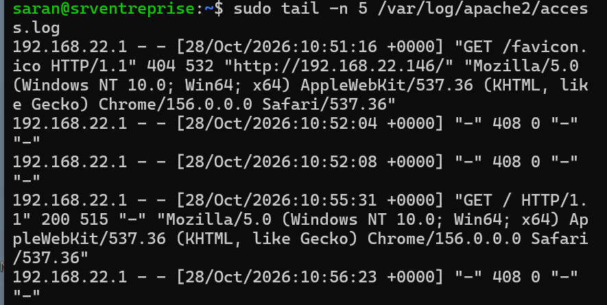

*📷 Pour voir le résultat : capture [`04-logs.png`](captures/04-logs.png) — journal Apache.*

**Résultat :** la page s'affiche depuis le PC Windows. Le journal montre la requête `GET /` avec le code **200** (succès) venant de l'adresse du PC (192.168.22.1).

Fichier de la page : [`index.html`](index.html)

---

## 5. Pare-feu ufw

**But :** bloquer tout le trafic entrant, sauf les deux services utiles : **SSH** (port 22) pour l'administration et **HTTP** (port 80) pour le site web.

```bash
# Politique par défaut : bloquer tout ce qui entre, autoriser ce qui sort
sudo ufw default deny incoming
sudo ufw default allow outgoing

# Autoriser SSH AVANT d'activer le pare-feu, pour ne pas couper la connexion
sudo ufw allow OpenSSH

# Autoriser le serveur web (port 80)
sudo ufw allow "Apache"

# Activer le pare-feu (il reste actif après un redémarrage)
sudo ufw enable

# Afficher l'état et les règles
sudo ufw status verbose
```

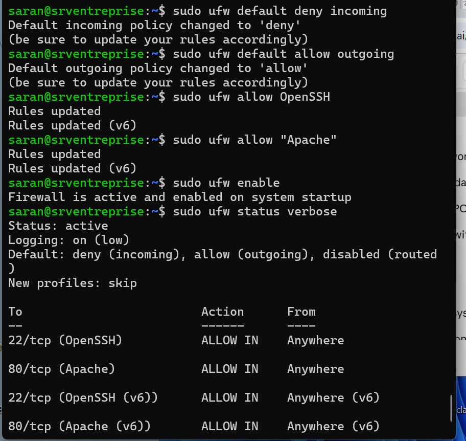

*📷 Pour voir le résultat : capture [`05-ufw.png`](captures/05-ufw.png) — règles du pare-feu.*

**Résultat :** le pare-feu est actif. Seuls les ports **22/tcp** et **80/tcp** sont ouverts. La page web et la connexion SSH fonctionnent toujours.

---

## 6. Sauvegarde automatique (Bash + cron)

**But :** sauvegarder chaque nuit les données importantes (dossiers partagés, site web, configuration d'Apache) et supprimer automatiquement les sauvegardes de plus de 7 jours.

### Le script

Fichier `/usr/local/bin/sauvegarde.sh` ([voir le fichier](sauvegarde.sh)) :

```bash
#!/bin/bash
# Sauvegarde des dossiers partagés, du site web et de la configuration Apache
set -euo pipefail                      # arrêter le script à la moindre erreur

DEST="/var/backups/serveur"            # dossier des sauvegardes
DATE=$(date +%Y-%m-%d_%H-%M)           # date et heure, ex. 2026-10-28_11-01
FICHIER="$DEST/sauvegarde_$DATE.tar.gz"

mkdir -p "$DEST"                       # créer le dossier s'il n'existe pas
tar -czf "$FICHIER" /srv/partage /var/www/html /etc/apache2   # archive compressée

# Supprimer les sauvegardes de plus de 7 jours
find "$DEST" -name "sauvegarde_*.tar.gz" -mtime +7 -delete

# Noter le résultat dans un journal
echo "$(date '+%F %T') Sauvegarde OK : $FICHIER" >> /var/log/sauvegarde.log
```

### Test manuel

```bash
# Rendre le script exécutable, puis le lancer
sudo chmod +x /usr/local/bin/sauvegarde.sh
sudo /usr/local/bin/sauvegarde.sh

# Vérifier que l'archive existe et lire le journal
ls -lh /var/backups/serveur
cat /var/log/sauvegarde.log
```

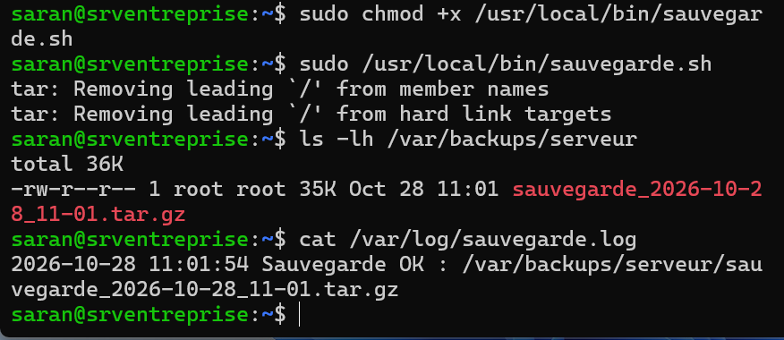

*📷 Pour voir le résultat : capture [`06-sauvegarde.png`](captures/06-sauvegarde.png) — sauvegarde créée.*

Vérification du contenu de l'archive (une sauvegarde non vérifiée ne vaut rien) :

```bash
# Lister les 15 premiers fichiers contenus dans la sauvegarde
sudo tar -tzf /var/backups/serveur/sauvegarde_*.tar.gz | head -n 15
```

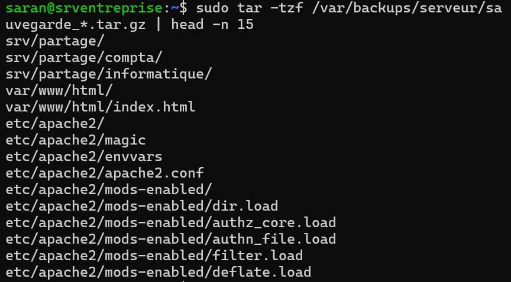

*📷 Pour voir le résultat : capture [`06-verification.png`](captures/06-verification.png) — contenu de la sauvegarde.*

### Programmation avec cron

```bash
# Programmer le script tous les jours à 2 h du matin, dans la crontab de root
# (format : minute heure jour-du-mois mois jour-de-la-semaine commande)
echo "0 2 * * * /usr/local/bin/sauvegarde.sh" | sudo crontab -

# Vérifier la tâche programmée
sudo crontab -l
```

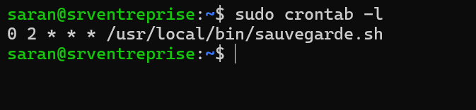

*📷 Pour voir le résultat : capture [`06-cron.png`](captures/06-cron.png) — tâche cron.*

**Résultat :** une archive datée est créée chaque nuit à 2 h, son résultat est noté dans `/var/log/sauvegarde.log`, et les sauvegardes de plus de 7 jours sont supprimées automatiquement.

---

## 7. Difficultés rencontrées et solutions

| Problème | Cause | Solution |
| --- | --- | --- |
| Connexion impossible après l'installation (« Login incorrect ») | Caractères différents de ceux attendus dans le mot de passe à cause de la disposition du clavier et de la touche Verr. Maj | Réinstallation avec un mot de passe testé en clair avant validation |
| `ssh: connect to host … port 22: Connection refused` | Le paquet OpenSSH n'était pas installé | Diagnostic avec `systemctl status ssh` et `ss -tlnp`, puis installation d'`openssh-server` |
| Dossier créé au mauvais endroit | Chemin écrit sans `/` au début (chemin relatif) | Suppression du mauvais dossier, puis utilisation du chemin absolu `/srv/partage/…` |
| Tâche de sauvegarde programmée deux fois | Commande d'ajout cron lancée deux fois | Remplacement de toute la crontab par une seule ligne |

---

## 8. Ce que j'ai appris

- Gérer les utilisateurs, les groupes et les droits Linux (`chmod`, `chown`, setgid).
- Sécuriser un accès SSH par clé et vérifier la configuration réellement appliquée avec `sshd -T`.
- Installer et configurer un service (Apache), puis lire ses journaux.
- Protéger un serveur avec un pare-feu en n'ouvrant que les ports nécessaires.
- Automatiser une tâche avec un script Bash et cron, et vérifier qu'une sauvegarde est exploitable.
- Diagnostiquer une panne méthodiquement : vérifier le service, le port, puis la configuration.

## Améliorations prévues

- Passer le site en HTTPS avec un certificat.
- Agrandir le volume LVM pour utiliser tout le disque.
- Copier les sauvegardes sur une autre machine.
